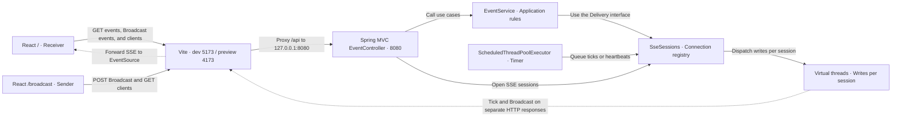
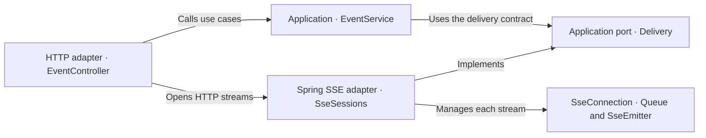
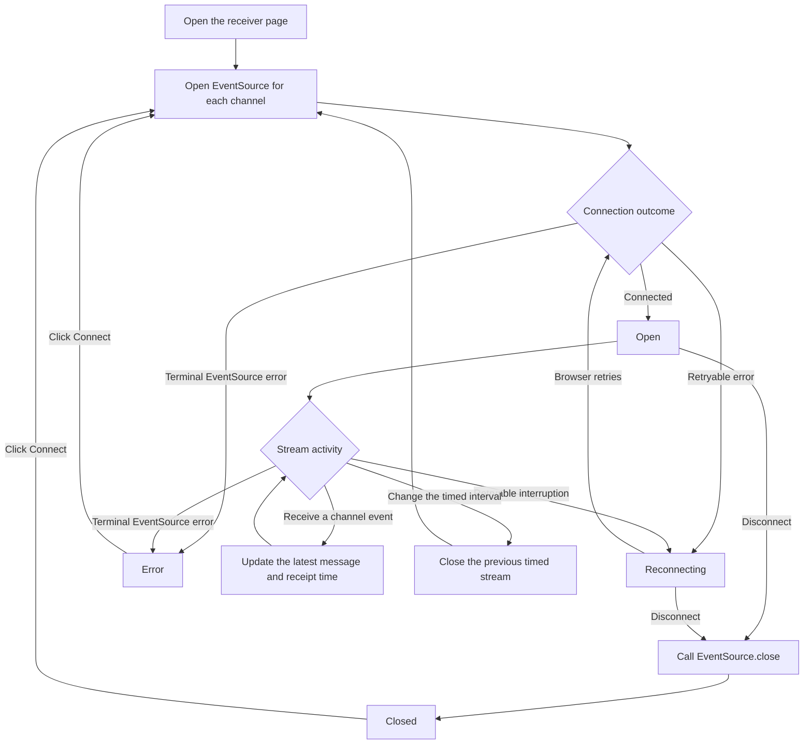
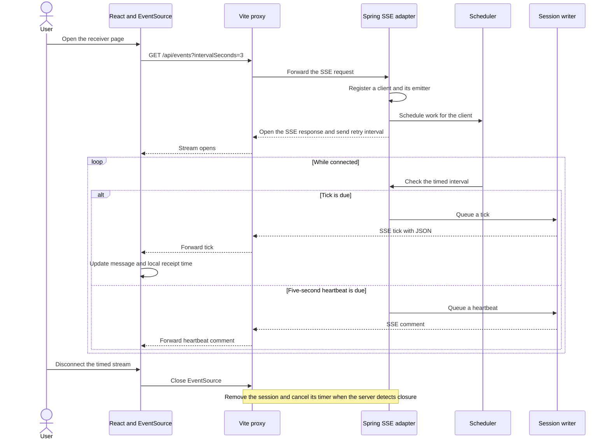
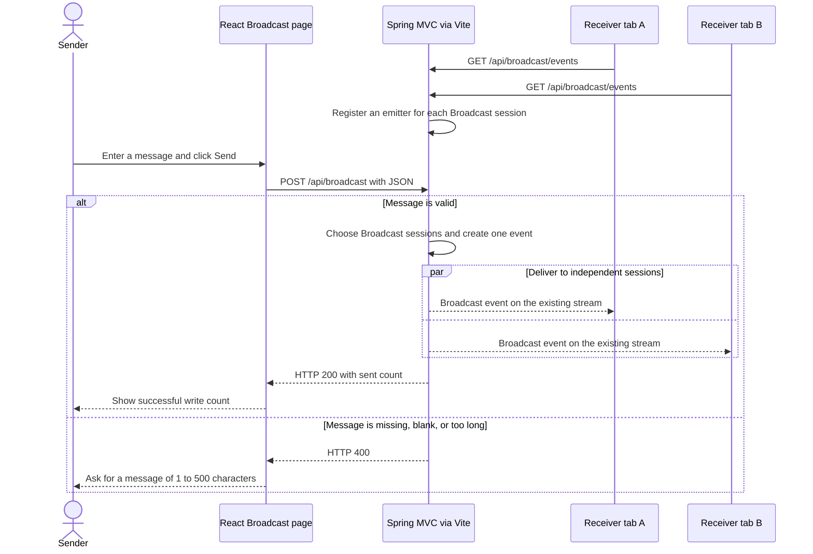

# Spring Boot + React SSE Demo

[ภาษาไทย](README.md) · **English**

This demo uses Server-Sent Events (SSE) to deliver two independent streams to each receiver tab. The home page displays the latest message and its local receipt time for each stream, along with the active connections. The `/broadcast` page publishes messages to connected Broadcast sessions on the same backend instance.

The design follows **Clean Architecture and SOLID principles**. Application rules live outside the Spring SSE adapter, and the React view delegates connection management to a hook.

**Contents** · [Quick start](#quick-start) · [Tech stack](#tech-stack) · [Architecture](#architecture) · [Clean Architecture and SOLID](#design-principles) · [Activity and sequence diagrams](#flows) · [API and wire format](#api) · [Backend](#backend) · [Frontend](#frontend) · [Verification](#verification) · [Browser E2E](#browser-e2e) · [Demo scope](#demo-scope) · [AI agent skill](#agent-skill)

<a id="quick-start"></a>

## Quick start

Run the commands from the repository root, which contains `backend/`, `frontend/`, and `tests/`. Keep the backend and frontend running in separate terminals. Use a third terminal for [Robot Framework](#browser-e2e).

| Component | Prerequisites | Default URL |
| --- | --- | --- |
| Backend | Java 21 and Maven | `http://localhost:8080` |
| Frontend dev | Node.js 20.19+ in the 20.x release line, or Node.js 22.12+, and npm | `http://localhost:5173` |
| Frontend preview | Same as frontend dev | `http://localhost:4173` |
| Robot Framework | Python 3.10+ and Chromium installed through Browser Library | Uses the frontend URL |

### Terminal 1 · Backend

```sh
mvn -f backend/pom.xml spring-boot:run
```

Once Spring Boot starts, `GET http://localhost:8080/api/clients` returns a JSON array. The array is empty until an SSE session opens.

### Terminal 2 · Frontend

Install dependencies on the first run and whenever `package-lock.json` changes.

```sh
npm --prefix frontend ci
```

Use dev mode with React Fast Refresh for local development.

```sh
npm --prefix frontend run dev
```

Use preview for Robot by default. Rebuild after frontend changes so preview serves the current files in `frontend/dist`.

```sh
npm --prefix frontend run build
npm --prefix frontend run preview -- --host localhost --port 4173 --strictPort
```

From inside `frontend/`, use `npm ci` or `npm run dev` directly. To start preview from that directory, use:

```sh
npm run build
npm run preview -- --host localhost --port 4173 --strictPort
```

Both Vite modes proxy `/api` to `http://127.0.0.1:8080`. For Robot against dev, use the URL printed by Vite as `BASE_URL`.

### Try the demo

1. Open [dev](http://localhost:5173/) or [preview](http://localhost:4173/). The page automatically opens both SSE streams and starts polling the connection list.
2. Enter a positive integer and click **ใช้ช่วงเวลานี้** (Apply interval). Clear the input and apply it to restore the one-second default. Applying a different interval while connected reopens the timed stream.
3. Open a second receiver tab with a different interval. Each tab receives random food messages on its own schedule.
4. Once both Broadcast panels are connected, click **ส่ง Broadcast (เปิดแท็บใหม่)** (Send Broadcast in a new tab). Enter a message and click **ส่งข้อความ** (Send). Both receivers display it in the Broadcast panel until another Broadcast arrives.
5. Click **ตัดการเชื่อมต่อ** (Disconnect) in either panel to close that stream. The panel keeps its latest message and receipt time. The table updates after the server detects the closure and the next poll finishes.

<a id="tech-stack"></a>

## Tech stack

| Component | Technology | Role |
| --- | --- | --- |
| Backend | Java 21, Spring Boot 3.5.7, Spring MVC, embedded Tomcat | Exposes REST APIs and asynchronous HTTP responses with `SseEmitter` |
| Serialization | Jackson | Reads Broadcast requests and serializes API responses and SSE payloads |
| Scheduling and writes | `ScheduledThreadPoolExecutor`, Java virtual threads | Schedules ticks and heartbeats on two timer workers and writes SSE on separate virtual threads |
| In-memory state | `ConcurrentHashMap`, `AtomicLong`, `UUID` | Tracks connections, assigns event sequence numbers, and generates client IDs |
| Backend build | Maven and Spring Boot Maven Plugin | Resolves dependencies and builds an executable JAR |
| Frontend | React and React DOM 19.3.0, JSX, CSS | Renders the receiver and Broadcast pages |
| Frontend build | Vite 8.3.0, React plugin, Node.js, npm | Enables Fast Refresh, proxies API calls, and builds static assets |
| Browser APIs | `EventSource`, `fetch`, `AbortController`, `Intl.DateTimeFormat` | Streams events, calls REST APIs, cancels polling, and formats local times |
| Testing | JUnit 5, Spring MockMvc, Node test runner, Robot Framework Browser | Checks application rules, API contracts, SSE lifecycle, and real browser flows |

<a id="architecture"></a>

## Architecture



The browser calls relative `/api` URLs on the frontend origin. SSE carries server-to-browser messages over a long-lived HTTP response. Sending a Broadcast uses a separate POST. Each stream owns an emitter and a client UUID.

<a id="design-principles"></a>

## Clean Architecture and SOLID principles

`EventController` adapts HTTP to the application and SSE transport. `EventService` owns the application-level `Delivery` interface. `SseSessions` implements that interface using Spring SSE. `SseDemoApplication` wires the service, adapter, and executors.



| Principle | How it applies |
| --- | --- |
| Single Responsibility | The controller maps HTTP, the service owns rules, and the adapter manages delivery and lifecycle. React separates rendering, connection state, and REST calls. |
| Open/Closed | A new delivery mechanism can implement the existing `Delivery` contract. `Channel` centralizes the supported channel names. |
| Liskov Substitution | The SSE adapter and the test implementation obey the same delivery contract for recipient counts and session listings. |
| Interface Segregation | `Delivery` exposes publishing and client listing. Stream opening, heartbeat scheduling, and cleanup stay in the adapter. |
| Dependency Inversion | The service depends on its own delivery contract and an injected `Clock`. Application tests supply a test adapter and fixed time without starting Spring MVC. |

<a id="flows"></a>

## Activity and sequence diagrams

### Activity · Receiver connection lifecycle



### Sequence · Open the timed stream



### Sequence · Send a Broadcast



<a id="api"></a>

## API and wire format

| Method and path | Input | Response |
| --- | --- | --- |
| `GET /api/events` | `intervalSeconds` is an integer from 1 to 2,147,483,647. Missing or empty means 1. | `200 text/event-stream`. An invalid interval returns empty `400` even with `Accept: text/event-stream`. A stopped session manager returns empty `503`. |
| `GET /api/broadcast/events` | None | `200 text/event-stream` for Broadcast with heartbeat comments every five seconds. A stopped session manager returns empty `503`. |
| `GET /api/clients` | None | `200` and a JSON array sorted by `connectedAt`, then `id`. Empty is `[]`. |
| `POST /api/broadcast` | JSON such as `{"message":"Hello, everyone!"}`. The trimmed message length must be 1 to 500. | `200` with `{"sent":2}`, or `{"sent":0}` when no write succeeds. A missing, blank, or oversized message returns `400`. |

The client list has `Cache-Control: no-store`. Each item represents one stream. `channel` is `tick` or `broadcast`, and Broadcast sessions have `intervalSeconds: null`.

```json
[
  {
    "id": "f6832a03-f244-4c15-a5bd-4d604b386cba",
    "channel": "tick",
    "intervalSeconds": 3,
    "connectedAt": "2026-11-26T02:30:00Z"
  }
]
```

SSE responses include `Cache-Control: no-cache` and `X-Accel-Buffering: no` for proxies that support that header. Each stream begins with the comment `:stream opened` and reconnect hint `retry:3000`. A blank line terminates an SSE event. Examples from the timed and Broadcast streams follow.

```text
id:1
event:tick
data:{"id":1,"timestamp":"2026-11-26T02:30:03Z","message":"I ate an apple."}

```

```text
id:2
event:broadcast
data:{"id":2,"timestamp":"2026-11-26T02:30:04Z","message":"Hello, everyone!"}

```

`event` selects the browser listener. The payload `timestamp` is the server's UTC time. The receiver instead displays the browser's local receipt time and formats `connectedAt` in its local time zone. Client UUIDs are per connection. Event IDs share a process-level counter, and all recipients of the same Broadcast receive the same event ID. `sent` counts server writes that complete in time. The browser provides no application-level acknowledgment.

<a id="backend"></a>

## Backend

[backend/pom.xml](backend/pom.xml) defines Spring Boot, Java 21, the Web and Test starters, and the executable JAR plugin. Surefire loads Mockito as a JVM agent at test startup.

| File | Responsibility |
| --- | --- |
| [SseDemoApplication.java](backend/src/main/java/demo/sse/SseDemoApplication.java) | Wires the application and adapter, and creates the named `sse-timer-` and `sse-writer-` executors. |
| [EventController.java](backend/src/main/java/demo/sse/EventController.java) | Maps the four HTTP routes, serializes channel names, and handles bad input and unavailable SSE sessions. |
| [EventService.java](backend/src/main/java/demo/sse/application/EventService.java) | Validates and trims Broadcast messages, generates tick messages and event IDs, sorts clients, and calls `Delivery`. |
| [SseSessions.java](backend/src/main/java/demo/sse/adapter/SseSessions.java) | Creates and registers emitters, selects sessions by channel, schedules periodic work, and coordinates shutdown. |
| [SseConnection.java](backend/src/main/java/demo/sse/adapter/SseConnection.java) | Serializes writes per session, bounds pending work, and centralizes cleanup. It requests emitter completion on a named `sse-close-` virtual thread and logs completion failures. |

### Delivery and slow clients

- The timer checks the timed channel each second. It queues a tick when the configured interval is due, or a heartbeat when a five-second boundary has no tick. Broadcast sessions queue a heartbeat every five seconds.
- Virtual threads handle writes separately from the timer and HTTP request threads. A busy session skips periodic tick or heartbeat work. Each session can hold eight pending Broadcast writes in addition to an active write.
- The asynchronous POST waits up to three seconds for each queued write. Full queues and timed-out writes do not count toward `sent`. On timeout the adapter removes the session and requests emitter completion. A socket write already in progress may remain blocked until the container or network releases it.
- Completion, timeout, and write failure remove the session and cancel its timer. During shutdown, `SmartLifecycle` stops accepting new SSE sessions and requests emitter completion before the web server begins graceful shutdown.

<a id="frontend"></a>

## Frontend

| File | Responsibility |
| --- | --- |
| [index.html](frontend/index.html) | Declares the Thai UI and the React mount point. |
| [package.json](frontend/package.json) and [package-lock.json](frontend/package-lock.json) | Define versions, npm scripts, and reproducible installs. |
| [vite.config.js](frontend/vite.config.js) | Registers the React plugin and proxies `/api` in dev and preview. |
| [main.jsx](frontend/src/main.jsx) | Selects the page from the URL and mounts it under `StrictMode`. |
| [ReceiverPage.jsx](frontend/src/pages/ReceiverPage.jsx) | Composes both panels and validates the timed interval form. |
| [BroadcastPage.jsx](frontend/src/pages/BroadcastPage.jsx) | Submits messages, prevents duplicate requests, and displays counts or errors. |
| [StreamPanel.jsx](frontend/src/components/StreamPanel.jsx) | Displays stream status, controls, and the latest message. |
| [ConnectedClients.jsx](frontend/src/components/ConnectedClients.jsx) | Polls for and renders active streams on both pages. |
| [Navigation.jsx](frontend/src/components/Navigation.jsx) | Links the receiver and Broadcast pages. |
| [useEventStream.js](frontend/src/hooks/useEventStream.js) | Owns EventSource lifecycle, status, and the latest message for one panel. |
| [api.js](frontend/src/api.js) and [streamData.js](frontend/src/streamData.js) | Execute REST requests and validate interval input and SSE payloads. |
| [styles.css](frontend/src/styles.css) | Styles the layout, connection indicators, large receipt clocks, and scrollable table. |

Each panel starts in `connecting`. The hook distinguishes `open`, `reconnecting`, a terminal `error`, and a manual `closed`. It closes the EventSource when the connection is disabled, the endpoint changes, or the panel unmounts. Invalid SSE data leaves the latest message intact.

`intervalInput` stores the draft value. `appliedInterval` stores a validated decimal integer or an empty value for the default. An interval change reopens only the timed stream while it is enabled. If that stream is closed or in error, the next manual connection uses the saved interval.

`ConnectedClients` uses `fetchClients()` and schedules another request two seconds after the current one finishes. It aborts the active request and cancels the timer when unmounted. `BroadcastPage` uses `publishBroadcast()` and gives specific validation feedback for HTTP 400. The receiver page's navigation link opens the sender in a new tab with `noopener`, allowing the receiver tab to stay connected.

<a id="verification"></a>

## Verification

Run backend unit and integration tests and frontend tests from the repository root.

```sh
mvn -f backend/pom.xml test
npm --prefix frontend test
```

Backend tests cover message rules, deterministic sorting, slow-session isolation, the queue cap, interval defaults, HTTP 400 and 503, channel separation, timeout cleanup, and emitter completion. Frontend tests cover interval parsing, malformed SSE payloads, and the REST request contract.

To inspect SSE on the wire, run each stream in a separate terminal. Use Ctrl+C to end a stream.

```sh
curl -Ni http://localhost:8080/api/events
curl -Ni 'http://localhost:8080/api/events?intervalSeconds=3'
curl -Ni http://localhost:8080/api/broadcast/events
```

With a Broadcast stream open, list sessions, publish a message, and verify interval validation.

```sh
curl -fsS http://localhost:8080/api/clients
curl -fsS http://localhost:8080/api/broadcast \
  -H 'Content-Type: application/json' \
  --data '{"message":"Hello, everyone!"}'
curl -i 'http://localhost:8080/api/events?intervalSeconds=0'
```

Expect the Broadcast event only in the Broadcast stream, a matching successful write count, and HTTP 400 for interval `0`. Build the backend JAR and frontend assets with:

```sh
mvn -f backend/pom.xml package
npm --prefix frontend run build
```

The outputs are `backend/target/sse-demo-0.0.1-SNAPSHOT.jar` and `frontend/dist/`.

<a id="browser-e2e"></a>

## Browser E2E with Robot Framework

The [Robot suite](tests/e2e/sse.robot) runs Chromium against React and Spring Boot through the Vite proxy. It covers seven flows:

1. Open both streams automatically and receive a timed message.
2. Send a Broadcast to at least two recipients and verify the exact message in both tabs.
3. Disconnect Broadcast and confirm timed messages continue.
4. Submit an invalid interval and verify the Thai validation message and continued timed delivery.
5. Set a two-second interval, observe the new SSE request, and confirm Broadcast stays connected.
6. Reconnect Broadcast manually and receive a new message.
7. Verify both channel types in the client list and wait up to 15 seconds for the closed timed session's ID to disappear after heartbeat detection and polling.

The Broadcast count can exceed two if other recipients are connected. The suite checks the minimum count and the unique message received by both test tabs.

### Terminal 3 · Install Robot and Chromium

From the repository root, set up the virtual environment on the first run and refresh it when the requirements change.

```sh
python3 -m venv tests/e2e/.venv
source tests/e2e/.venv/bin/activate
python -m pip install -r tests/e2e/requirements.txt
rfbrowser install chromium
```

In a new terminal, run `source tests/e2e/.venv/bin/activate` from the repository root before running `robot`. [Robot Framework Browser installation guide](https://robotframework-browser.org/docs/start/installation/)

### Check readiness

Keep Spring Boot and Vite Preview running as described in [Quick start](#quick-start). Adjust the frontend port if using dev.

```sh
curl -fsS http://localhost:8080/api/clients
curl -fsS -o /dev/null -w 'Frontend HTTP %{http_code}\n' http://localhost:4173/
curl -fsS http://localhost:4173/api/clients
```

The first and last requests should return JSON arrays, and the middle request should report `Frontend HTTP 200`. The last request checks the proxy. Use a test instance because Broadcast sends messages to every subscribed Broadcast session on that backend.

### Run the suite

Run headless:

```sh
robot --outputdir tests/e2e/results tests/e2e/sse.robot
```

To watch Chromium, delay browser actions by one second and leave each result visible for eight seconds:

```sh
robot --variable HEADLESS:False --variable SLOW_MO:1s \
  --variable VIEW_DELAY:8s \
  --outputdir tests/e2e/results tests/e2e/sse.robot
```

| Variable | Default | Use |
| --- | --- | --- |
| `BASE_URL` | `http://localhost:4173` | Frontend origin. A trailing slash is optional. For dev, pass `--variable BASE_URL:http://localhost:5173`. |
| `HEADLESS` | `True` | Set to `False` to show Chromium. |
| `SLOW_MO` | `0s` | Delays browser actions. |
| `VIEW_DELAY` | `4s` | Keeps each result visible before closing the context in headed mode. |

### Reports and troubleshooting

Results are under `tests/e2e/results/`. Open `report.html` for the summary, `log.html` for diagnostics, or `output.xml` for machine-readable results. On macOS, run `open tests/e2e/results/report.html`.

| Symptom | What to check |
| --- | --- |
| npm reports `ENOENT` for `frontend/frontend/package.json` | From inside `frontend/`, run `npm run ...` directly. Use `--prefix frontend` from the repository root. |
| Robot reports `ERR_CONNECTION_REFUSED` on 4173 | Keep Vite Preview running, or set `BASE_URL` to the dev URL. |
| The page loads but neither stream connects | Check `/api/clients` through the frontend port and confirm Spring Boot is listening on 8080. |
| Chromium executable is missing | Activate the virtual environment and run `rfbrowser install chromium`. |
| Chromium closes too quickly | Check `log.html` for navigation errors, then use `HEADLESS:False` and increase `SLOW_MO` or `VIEW_DELAY`. |

<a id="demo-scope"></a>

## Demo scope

The client registry and event sequence exist in one Spring Boot process and reset on restart. A reconnected browser receives new events from its new connection. The demo does not replay missed messages using `Last-Event-ID`. A Broadcast reaches sessions on the process handling the POST.

During development, React `StrictMode` may open and close extra streams while checking cleanup. Stale sessions can stay visible until the backend detects closure and the next polling request finishes. The endpoints are accessible without sign-in.

<a id="agent-skill"></a>

## AI agent skill

Use [`sse-demo-maintenance`](skills/sse-demo-maintenance/SKILL.md) to review or modify this demo. It records channel invariants, architectural boundaries, the unit and integration testing expectations, the browser suite, and documentation update rules. If an agent does not discover the skill automatically, give it the file path.

GitHub renders the Mermaid code fences in this README. [GitHub Docs · Creating diagrams](https://docs.github.com/en/get-started/writing-on-github/working-with-advanced-formatting/creating-diagrams)
