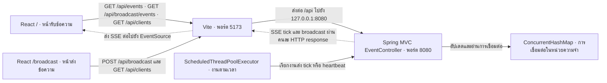
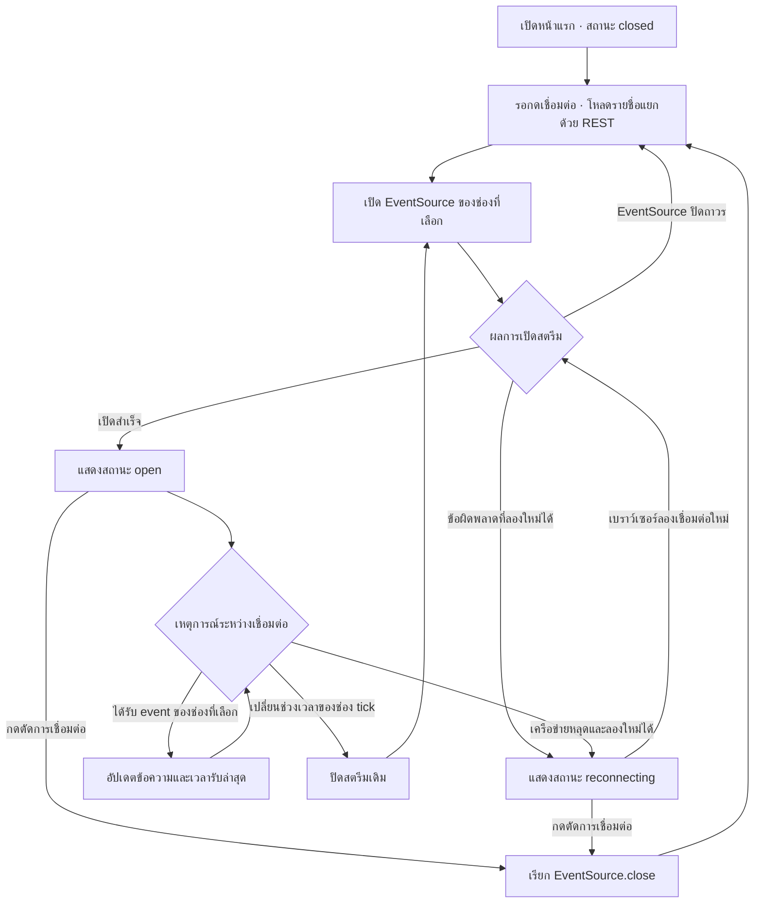
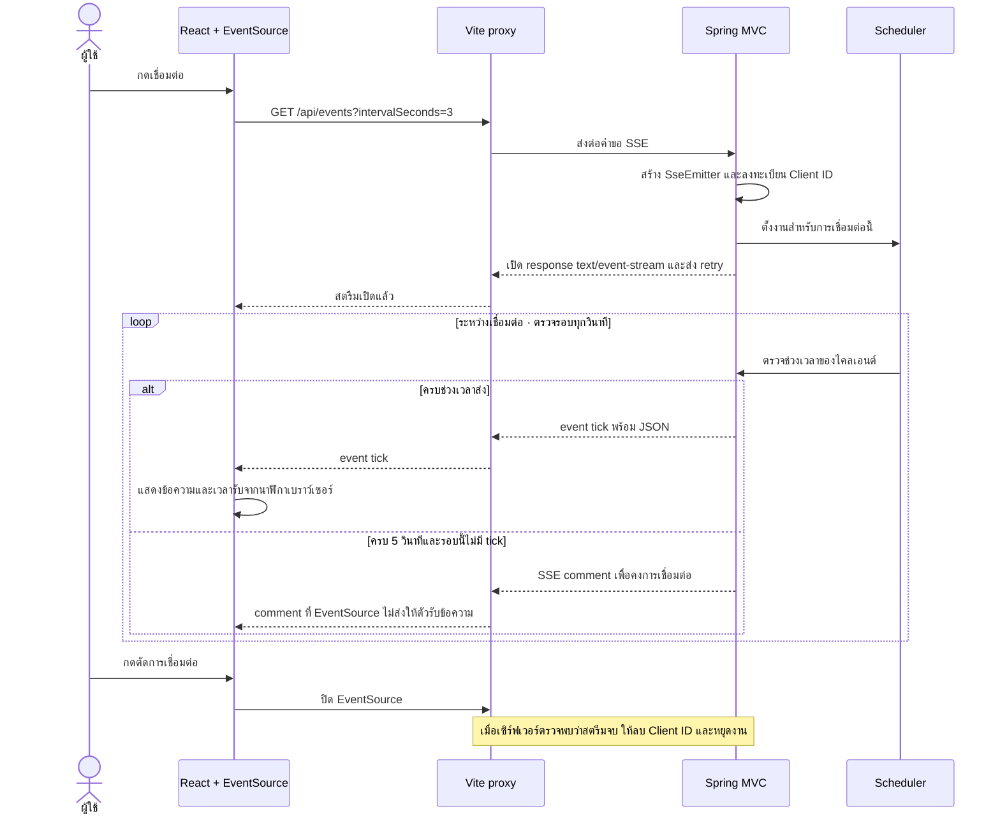
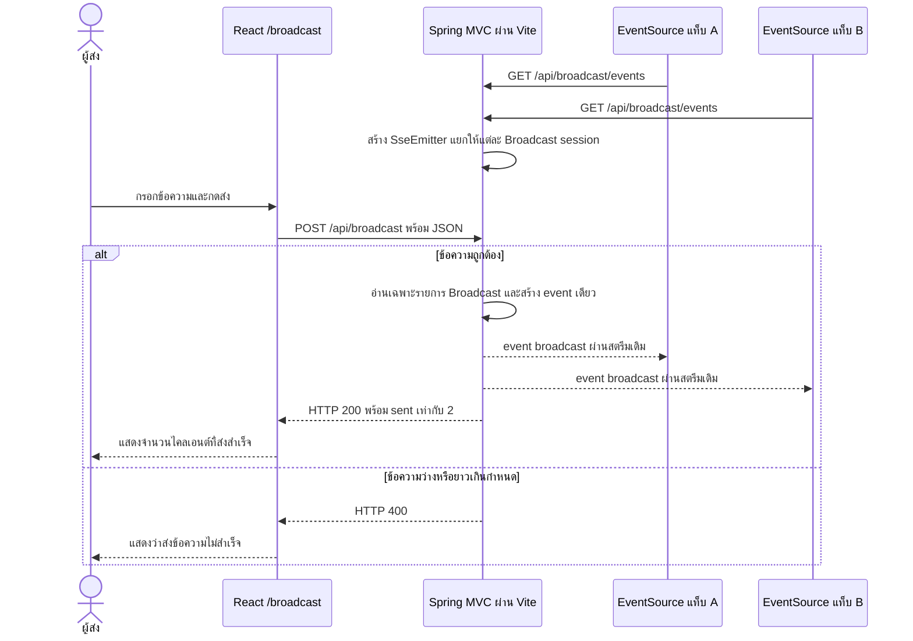

# Spring Boot + React SSE Demo

เดโมนี้ให้เบราว์เซอร์เปิดการเชื่อมต่อ HTTP แบบ Server-Sent Events (SSE) แยกกันได้สองสตรีมต่อแท็บ แล้วรับข้อความที่ Spring Boot ส่งเข้ามาเรื่อย ๆ หน้าแรกแสดงข้อความและเวลารับล่าสุดแยกตามช่อง พร้อมรายชื่อไคลเอนต์ ส่วนหน้า `/broadcast` ใช้ส่งข้อความทันทีถึงทุกการเชื่อมต่อในช่อง Broadcast ของเซิร์ฟเวอร์เดียวกัน

**สารบัญ** · [เริ่มใช้งาน](#quick-start) · [Tech stack](#tech-stack) · [สถาปัตยกรรม](#architecture) · [Activity และ Sequence](#flows) · [API และรูปแบบข้อความ](#api) · [โค้ด Backend](#backend) · [โค้ด Frontend](#frontend) · [ตรวจสอบการทำงาน](#verification) · [ขอบเขตเดโม](#demo-scope)

<a id="quick-start"></a>

## เริ่มใช้งาน

ต้องมี Java 21, Maven และ Node.js ตามที่ Vite กำหนด (`^20.19.0 || >=22.12.0`) พร้อม npm เปิดสองเทอร์มินัลจากโฟลเดอร์หลักของโปรเจกต์

**เทอร์มินัล 1 · Backend**

```sh
mvn -f backend/pom.xml spring-boot:run
```

**เทอร์มินัล 2 · Frontend**

```sh
npm --prefix frontend ci
npm --prefix frontend run dev
```

1. เปิด [หน้าแรก](http://localhost:5173/) หรือ URL ที่ Vite แสดง หน้าเว็บเริ่มโหลดรายชื่อไคลเอนต์ทันที ส่วน แต่ละสตรีมจะเริ่มเมื่อกด **เชื่อมต่อ** ในช่องนั้น
2. กรอกจำนวนวินาที แล้วกด **ใช้ช่วงเวลานี้** เพื่อบันทึกค่า เว้นว่างเพื่อใช้ค่าเริ่มต้น 1 วินาที หากตั้งค่าขณะเชื่อมต่ออยู่ หน้าเว็บจะเปิดสตรีมใหม่ด้วยค่าที่เพิ่งตั้ง
3. เปิดหน้าแรกอีกแท็บ กด **เชื่อมต่อ** ในช่อง **ข้อความตามเวลา** และลองตั้งช่วงเวลาต่างกัน แต่ละแท็บจะได้รับข้อความสุ่มตามช่วงเวลาของตัวเอง
4. กด **เชื่อมต่อ** ในช่อง **ข้อความ Broadcast** ของทั้งสองแท็บ แล้วกด **ส่ง Broadcast (เปิดแท็บใหม่)** จากหน้าแรก กรอกข้อความ เช่น `Hello, everyone!` แล้วกด **ส่งข้อความ** ทั้งสองแท็บรับข้อความได้ทันที ข้อความ Broadcast จะอยู่ในช่องของตัวเองจนกว่าจะได้รับ Broadcast ครั้งถัดไป
5. กด **ตัดการเชื่อมต่อ** ในช่องที่ต้องการเพื่อปิดเฉพาะสตรีมนั้น ข้อความและเวลารับล่าสุดจะยังแสดงอยู่ รายชื่อไคลเอนต์จะอัปเดตเมื่อเซิร์ฟเวอร์ตรวจพบการปิดและหน้าเว็บดึงรายชื่อรอบถัดไป

<a id="tech-stack"></a>

## Tech stack

| ส่วน | เทคโนโลยี | บทบาทในเดโม |
| --- | --- | --- |
| Backend | Java 21, Spring Boot 3.5.7, Spring MVC | เปิด REST API และ async HTTP response ด้วย `SseEmitter` ผ่าน embedded Tomcat จาก `spring-boot-starter-web` |
| JSON | Jackson ผ่าน Spring MVC | อ่าน JSON สำหรับ Broadcast และแปลง Java records เป็น REST response กับ JSON ใน SSE |
| งานตามเวลา | `ScheduledThreadPoolExecutor` | รันงานตามเวลาของแต่ละการเชื่อมต่อด้วย worker pool ขนาด 2 |
| ข้อมูลขณะรัน | `ConcurrentHashMap`, `AtomicLong`, `UUID` | เก็บการเชื่อมต่อในหน่วยความจำ สร้าง Event ID และกำหนด Client ID |
| Backend build | Maven, Spring Boot Maven Plugin | จัดการ dependencies และสร้าง executable JAR |
| Frontend | React และ React DOM 19.3.0, JavaScript/JSX, CSS | จัดการสถานะและแสดงหน้ารับข้อความ หน้า Broadcast และรายชื่อไคลเอนต์ |
| Frontend build | Vite 8.3.0, Node.js, npm | เสิร์ฟหน้าเว็บระหว่างพัฒนา ส่งต่อ `/api` ไป Backend และ build ไฟล์ใน `frontend/dist` |
| Browser APIs | `EventSource`, `fetch`, `AbortController`, `Intl.DateTimeFormat` | รับ SSE, เรียก JSON API, ยกเลิกการโหลดรายชื่อ และจัดรูปแบบเวลาท้องถิ่น |

<a id="architecture"></a>

## สถาปัตยกรรม



เบราว์เซอร์เรียกเส้นทาง `/api` แบบ relative URL จึงติดต่อ origin เดียวกับหน้า React ระหว่างพัฒนาและเมื่อใช้ Vite Preview โดย Vite ส่งต่อทั้ง REST และสตรีมไป Spring Boot ส่วน `EventSource` รับข้อมูลทางเดียวจากเซิร์ฟเวอร์ การกดส่ง Broadcast ใช้ HTTP POST อีกคำขอหนึ่ง จากนั้นเซิร์ฟเวอร์กระจาย event ไปยังสตรีม Broadcast ที่เปิดอยู่ โดยแต่ละสตรีมมี `SseEmitter` และ Client ID ของตัวเอง

<a id="flows"></a>

## Activity และ Sequence

### Activity diagram · วงจรการเชื่อมต่อ



### Sequence diagram · เปิดสตรีมและรับข้อความตามเวลา



### Sequence diagram · ส่ง Broadcast



<a id="api"></a>

## API และรูปแบบข้อความ

| Method และ path | Input | ผลลัพธ์ |
| --- | --- | --- |
| `GET /api/events` | Query `intervalSeconds` เป็นจำนวนเต็ม 1 ถึง 2,147,483,647 ค่าเริ่มต้น 1 เมื่อไม่ส่งหรือส่งค่าว่าง | `200 text/event-stream` และคง response ไว้ ค่าผิดรูปแบบหรือนอกช่วงได้ `400` |
| `GET /api/broadcast/events` | ไม่มี | `200 text/event-stream` สำหรับข้อความ Broadcast โดยเฉพาะ ระหว่างรอข้อความจะส่ง comment ทุก 5 วินาที |
| `GET /api/clients` | ไม่มี | `200` พร้อม JSON array เรียงตาม `connectedAt` ถ้าไม่มีไคลเอนต์จะได้ `[]` |
| `POST /api/broadcast` | `Content-Type: application/json` และ body เช่น `{"message":"Hello, everyone!"}` ข้อความหลังตัดช่องว่างหัวท้ายต้องมีความยาว 1–500 | `200` พร้อม `{"sent":2}` หรือ `{"sent":0}` หากส่งไม่สำเร็จถึงไคลเอนต์ใดเลย ข้อความว่างหรือยาวเกินกำหนดได้ `400` |

`GET /api/clients` มี `Cache-Control: no-store` และคืนข้อมูลต่อการเชื่อมต่อ เช่น

```json
[
  {
    "id": "f6832a03-f244-4c15-a5bd-4d604b386cba",
    "channel": "tick",
    "intervalSeconds": 3,
    "connectedAt": "2026-11-26T02:30:00Z"
  }
]
```

API รายชื่อคืน `channel` เป็น `tick` หรือ `broadcast` โดยช่อง Broadcast มี `intervalSeconds: null`

สตรีม SSE มี `Cache-Control: no-cache` และ `X-Accel-Buffering: no` เพื่อบอกพร็อกซีที่รองรับให้ส่งข้อมูลต่อโดยไม่รอสะสม สตรีมเริ่มด้วย comment `:stream opened` และ `retry:3000` เป็นค่าหน่วง 3,000 มิลลิวินาทีสำหรับการลองเชื่อมต่อใหม่ของเบราว์เซอร์ ตัวอย่างจากช่องข้อความตามเวลา

```text
id:1
event:tick
data:{"id":1,"timestamp":"2026-11-26T02:30:03Z","message":"I ate an apple."}

```

ตัวอย่างจากช่อง Broadcast

```text
id:2
event:broadcast
data:{"id":2,"timestamp":"2026-11-26T02:30:04Z","message":"Hello, everyone!"}

```

บรรทัดว่างคั่นแต่ละ event โดย `event` ระบุชื่อสำหรับ `addEventListener()` ส่วน `timestamp` เป็นเวลาบนเซิร์ฟเวอร์ใน UTC หน้าเว็บแสดงเวลาที่ได้รับจริงตามนาฬิกาเบราว์เซอร์จาก `new Date()` และแสดงเวลาเริ่มเชื่อมต่อจาก `connectedAt` ตามเขตเวลาท้องถิ่นของเบราว์เซอร์

Client ID เป็น UUID ที่สร้างใหม่ทุกครั้งเมื่อเปิดสตรีม Event ID เป็นเลขจากตัวนับร่วมภายในโปรเซส โดย Broadcast หนึ่งครั้งใช้ Event ID เดียวกันสำหรับทุกผู้รับ ค่า `sent` นับการเขียน SSE ที่ฝั่งเซิร์ฟเวอร์สำเร็จโดยไม่มี exception

<a id="backend"></a>

## โค้ด Backend

**[backend/pom.xml](backend/pom.xml)** กำหนด Spring Boot parent, Java version, Web starter และปลั๊กอินที่จัดแพ็กเกจ executable JAR

**[SseDemoApplication.java](backend/src/main/java/demo/sse/SseDemoApplication.java)** เป็นจุดเริ่ม Spring Boot และประกาศ bean `eventScheduler()` เป็น `ScheduledThreadPoolExecutor(2)` งานที่ถูกยกเลิกจะถูกนำออกจากคิวด้วย `setRemoveOnCancelPolicy(true)` เมื่อปิดแอป Spring เรียก `shutdownNow()`

**[EventController.java](backend/src/main/java/demo/sse/EventController.java)** รับทั้งสี่เส้นทางและจัดการอายุของสตรีม

| โค้ด | วิธีทำงาน |
| --- | --- |
| `tickClients`, `broadcastClients`, `Client`, `Connection` | ใช้ `ConcurrentHashMap` ให้ HTTP request และ worker เข้าถึงทะเบียนของแต่ละช่อง `Client` เก็บ UUID ชื่อช่อง ช่วงเวลา และเวลาเชื่อมต่อ ส่วน `Connection` จับคู่ข้อมูลนั้นกับ `SseEmitter` ของไคลเอนต์ |
| `subscribeTicks()`, `subscribeBroadcast()` และ `subscribe()` | ช่อง tick ใช้ `@RequestParam` รับช่วงเวลาส่งและตรวจค่าบวก ช่อง Broadcast เรียก helper ด้วยช่วงเวลา `null` ทั้งคู่สร้าง `SseEmitter(0L)` เพื่อเปิด async response โดยไม่ตั้ง emitter timeout จากนั้นส่ง comment เริ่มต้น ลงทะเบียนไคลเอนต์ และตั้งงานประจำ |
| งานจาก `scheduleAtFixedRate()` | เริ่มตรวจหลัง 1 วินาทีและตรวจทุกวินาที นับรอบด้วย `elapsedSeconds` ส่ง `tick` เมื่อหารด้วยช่วงเวลาลงตัว ส่วนรอบที่หาร 5 ลงตัวและไม่มี `tick` จะส่ง comment `:keep-alive` ช่อง Broadcast ตั้งงานทุก 5 วินาทีเพื่อส่ง comment |
| `sendTick()` และ `sendEvent()` | `sendTick()` สุ่มจากรายการอาหารและผลไม้ด้วย `ThreadLocalRandom` แล้วสร้าง record `StreamEvent` ที่มี `id`, `timestamp`, `message` ส่วน `sendEvent()` ใช้ร่วมกันเพื่อเขียน SSE event ชื่อ `tick` หรือ `broadcast` พร้อม JSON |
| การล้างการเชื่อมต่อ | `onCompletion`, `onTimeout` และ `onError` ใช้ cleanup เดียวกันเพื่อลบ Client ID และยกเลิกงาน หาก worker เขียนสตรีมไม่สำเร็จ จะลบรายการและหยุดงานประจำผ่าน exception |
| `connectedClients()` | ดึงเฉพาะข้อมูล `Client` จากทะเบียนทั้งสองช่อง เรียงตามเวลาเริ่มเชื่อมต่อ แล้วส่งเป็น JSON |
| `broadcast()` | ตรวจข้อความจาก `BroadcastRequest` สร้าง event หนึ่งตัวและวนส่งให้การเชื่อมต่อในทะเบียน Broadcast ณ ตอนส่ง หากเขียนถึงไคลเอนต์ใดไม่สำเร็จ จะลบรายการนั้นและส่งต่อให้รายอื่น งานประจำของรายการที่ถูกลบจะหยุดเมื่อตรวจรอบถัดไป |

<a id="frontend"></a>

## โค้ด Frontend

| ไฟล์ | บทบาท |
| --- | --- |
| [frontend/index.html](frontend/index.html) | กำหนดภาษาไทยและจุด mount `#root` แล้วโหลด React entry point |
| [frontend/package.json](frontend/package.json) และ [package-lock.json](frontend/package-lock.json) | กำหนดเวอร์ชันและคำสั่ง npm ใช้ lockfile กับ `npm ci` เพื่อให้ติดตั้ง dependencies ซ้ำได้ |
| [frontend/vite.config.js](frontend/vite.config.js) | ตั้ง proxy สำหรับ `/api` ไป `http://127.0.0.1:8080` ทั้งตอน `dev` และ `preview` |
| [frontend/src/main.jsx](frontend/src/main.jsx) | เลือกหน้าตาม `window.location.pathname` แล้ว mount ผ่าน `createRoot()` ภายใต้ `StrictMode` |
| [frontend/src/styles.css](frontend/src/styles.css) | จัดเลย์เอาต์ แสดงเวลาล่าสุดเป็นตัวเลขขนาดใหญ่ และให้ตารางเลื่อนแนวนอนได้บนจอแคบ |

**`App` และ `StreamPanel` · หน้ารับข้อความ**

- `App` แสดง `StreamPanel` สองตัว แต่ละตัวมี endpoint, EventSource, สถานะ และข้อความล่าสุดของตัวเอง
- `enabled` เริ่มจาก `false` และ `status` เริ่มจาก `closed` ปุ่มเชื่อมต่อเปลี่ยนสถานะให้ effect เปิด `new EventSource(endpoint)` สถานะ `connecting` คือกำลังเปิด, `open` คือเชื่อมต่อแล้ว และ `reconnecting` คือเบราว์เซอร์กำลังลองใหม่หลังข้อผิดพลาดชั่วคราว
- `intervalInput` คือค่าที่กำลังกรอก ส่วน `interval` คือค่าที่กดใช้แล้ว หากว่างจะใช้ `/api/events` โดยไม่มี query เมื่อเปลี่ยนค่าที่ใช้อยู่ระหว่างเชื่อมต่อช่อง tick `endpoint` เปลี่ยน ทำให้ effect ปิดสตรีมเดิมก่อนเปิดใหม่
- ตัวรับ event ของแต่ละ `StreamPanel` ฟังเฉพาะ `eventName` ของตัวเอง แปลง `event.data` จาก JSON และแทนที่ `latest` ด้วยข้อความและเวลารับล่าสุด `EventSource.close()` ใน cleanup หยุดสตรีมเมื่อกดตัดการเชื่อมต่อ เปลี่ยน endpoint หรือออกจากหน้า

**`ConnectedClients` · รายชื่อที่ใช้ร่วมกันทั้งสองหน้า**

- เรียก `fetch('/api/clients')` เมื่อเปิดหน้า แล้วตั้งรอบถัดไป 2 วินาทีหลังคำขอปัจจุบันเสร็จ การตั้งรอบใน `finally` ช่วยให้ลองใหม่หลังข้อผิดพลาดและเลี่ยงการยิงคำขอทับรอบเดิม
- ใช้ `AbortController` และ `clearTimeout()` เมื่อ component ถูกถอดออก หน้าแสดงสถานะกำลังโหลด ข้อผิดพลาด รายการว่าง หรือตารางตามข้อมูลที่ได้

**`BroadcastPage` และ `Navigation` · หน้าส่งและการนำทาง**

- ฟอร์มควบคุมค่าข้อความผ่าน React state และปิดปุ่มส่งระหว่างรอผลหรือเมื่อข้อความว่าง `sendBroadcast()` เรียก `fetch` แบบ POST พร้อม JSON และแสดงจำนวนจาก `sent` หรือข้อความแจ้งข้อผิดพลาด
- ลิงก์จากหน้าแรกเปิด `/broadcast` ในแท็บใหม่ด้วย `target="_blank"` และ `rel="noopener"` เพื่อให้แท็บเดิมรับ SSE ต่อได้

<a id="verification"></a>

## ตรวจสอบการทำงาน

เปิดสตรีมในเทอร์มินัลแยก `curl -N` จะพิมพ์ข้อมูลเมื่อได้รับ กด Ctrl+C เพื่อปิดสตรีม

```sh
curl -Ni http://localhost:8080/api/events
# หรือกำหนดช่วงเวลาส่งเอง
curl -Ni 'http://localhost:8080/api/events?intervalSeconds=3'
# เปิดช่อง Broadcast ในอีกเทอร์มินัล
curl -Ni http://localhost:8080/api/broadcast/events
```

ขณะอีกเทอร์มินัลยังเปิดสตรีม ให้ดูทะเบียนและทดสอบส่งข้อความ

```sh
curl -fsS http://localhost:8080/api/clients

curl -fsS http://localhost:8080/api/broadcast \
  -H 'Content-Type: application/json' \
  --data '{"message":"Hello, everyone!"}'

curl -i 'http://localhost:8080/api/events?intervalSeconds=0'
```

ผลที่ควรเห็นคือรายการมี UUID กับช่วงเวลาที่เลือก, Broadcast ปรากฏเป็น `event:broadcast` ในช่อง Broadcast ทันที ส่วนช่องตามเวลายังได้รับ `event:tick` ตามรอบเดิม, `sent` ตรงกับจำนวนที่เซิร์ฟเวอร์เขียนสำเร็จ และช่วงเวลา `0` ได้ HTTP `400`

สร้าง build จากโฟลเดอร์หลักด้วยคำสั่งต่อไปนี้

```sh
mvn -f backend/pom.xml package
npm --prefix frontend run build
```

ไฟล์ผลลัพธ์อยู่ที่ `backend/target/sse-demo-0.0.1-SNAPSHOT.jar` และ `frontend/dist/` ตามลำดับ

<a id="demo-scope"></a>

## ขอบเขตเดโม

ทะเบียนไคลเอนต์และตัวนับ Event ID อยู่ในหน่วยความจำของ Spring Boot หนึ่งโปรเซส จึงเริ่มใหม่ทุกครั้งที่รีสตาร์ต เมื่อเบราว์เซอร์เชื่อมต่อกลับ จะเปิดสตรีมใหม่และรับเฉพาะ event ที่เกิดหลังจากนั้น โค้ดปัจจุบันไม่มีประวัติสำหรับ replay จาก `Last-Event-ID` และ Broadcast ส่งเฉพาะการเชื่อมต่อในโปรเซสที่รับ POST ส่วนหน้าเว็บเก็บข้อความล่าสุดแยกตามสตรีม ข้อความ `tick` และ `broadcast` จึงอัปเดตเฉพาะช่องของตัวเอง

REST endpoints ของเดโมเปิดให้เรียกได้โดยไม่ต้องลงชื่อเข้าใช้ และรายชื่ออาจค้างชั่วคราวระหว่างรอให้เซิร์ฟเวอร์ตรวจพบว่าสตรีมหลุดกับรอบ polling ถัดไป

แผนภาพในเอกสารนี้ใช้ Mermaid code fence ที่ GitHub รองรับใน Markdown. [GitHub Docs · Creating diagrams](https://docs.github.com/en/get-started/writing-on-github/working-with-advanced-formatting/creating-diagrams)
