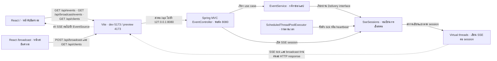
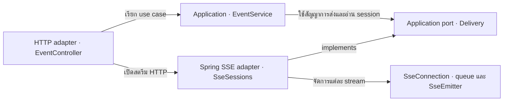
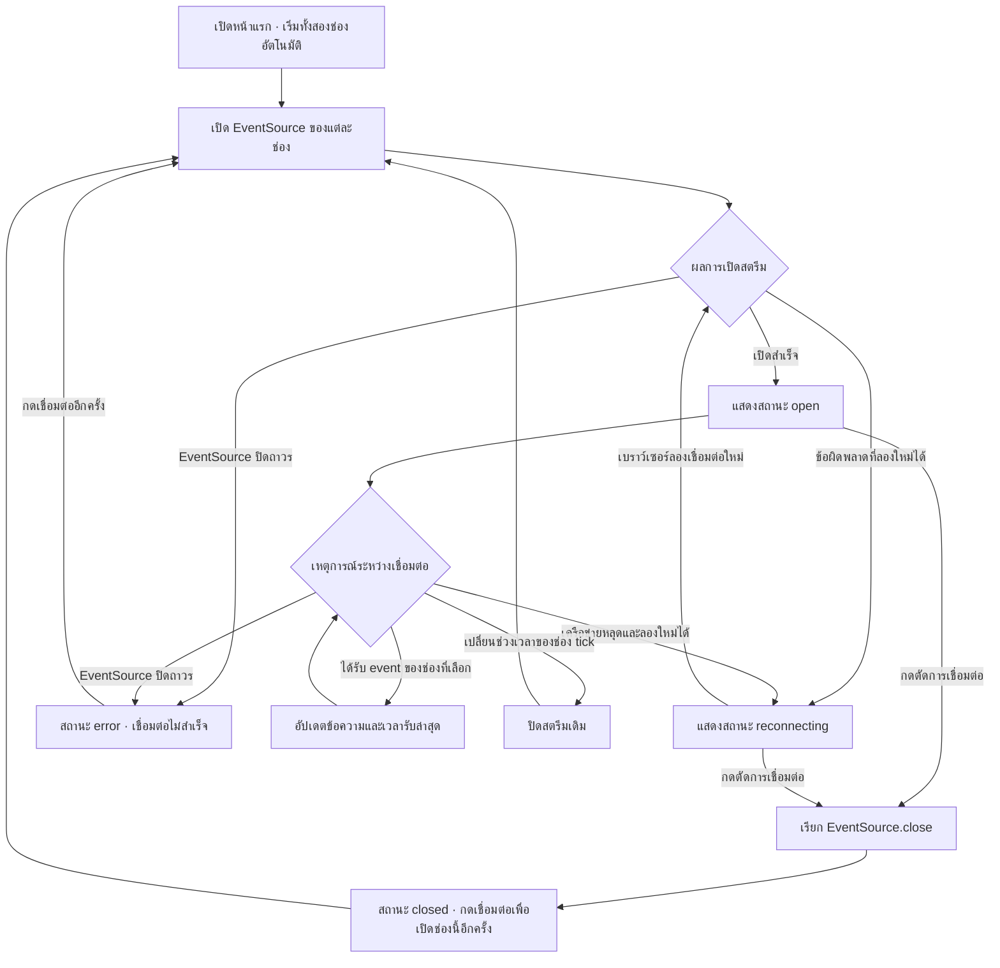
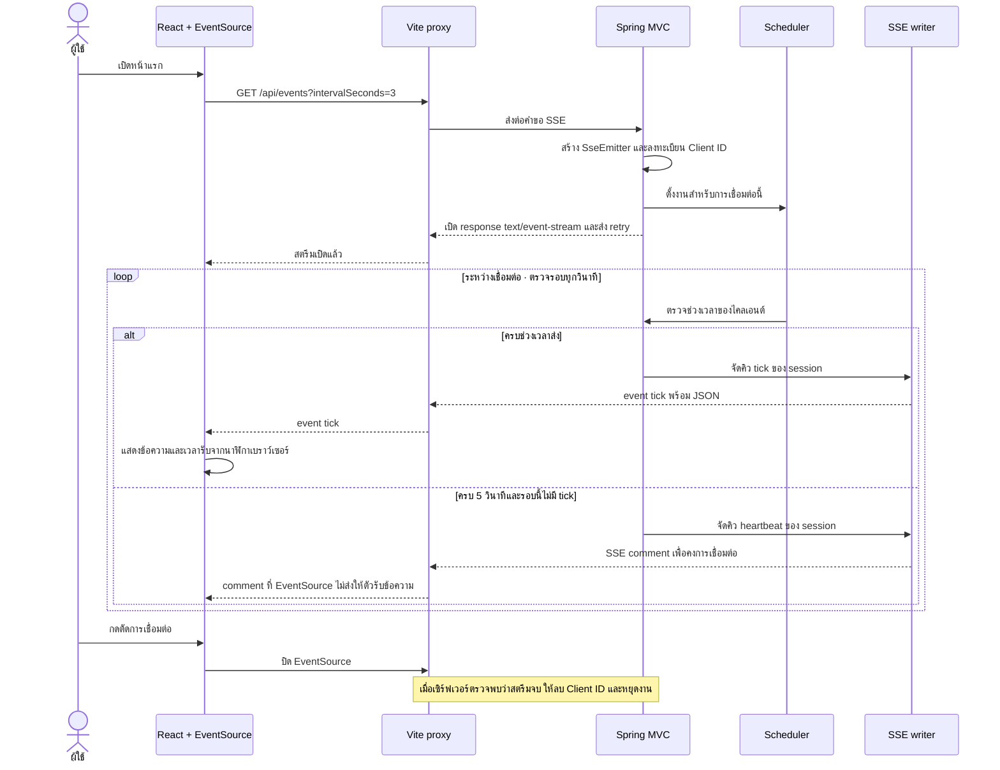
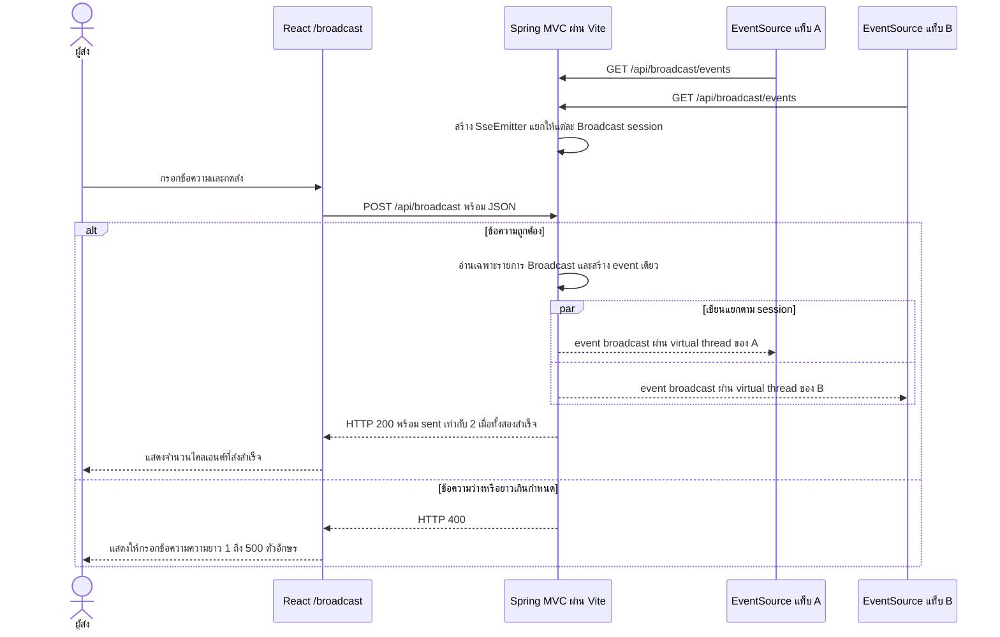

# Spring Boot + React SSE Demo

**ภาษาไทย** · [English](README.en.md)

เดโมนี้ให้เบราว์เซอร์เปิดการเชื่อมต่อ HTTP แบบ Server-Sent Events (SSE) แยกกันได้สองสตรีมต่อแท็บ แล้วรับข้อความที่ Spring Boot ส่งเข้ามาเรื่อย ๆ หน้าแรกแสดงข้อความและเวลารับล่าสุดแยกตามช่อง พร้อมรายชื่อไคลเอนต์ ส่วนหน้า `/broadcast` ใช้ส่งข้อความทันทีถึงทุกการเชื่อมต่อในช่อง Broadcast ของเซิร์ฟเวอร์เดียวกัน

โครงการใช้ **Clean Architecture และ SOLID Principles** เป็นพื้นฐานในการออกแบบขอบเขตงานและทิศทาง dependency โดยแยกกติกาการส่งข้อความออกจาก Spring SSE และแยกวงจรการเชื่อมต่อออกจาก React view

**สารบัญ** · [เริ่มใช้งาน](#quick-start) · [Tech stack](#tech-stack) · [สถาปัตยกรรม](#architecture) · [Clean Architecture และ SOLID](#design-principles) · [Activity และ Sequence](#flows) · [API และรูปแบบข้อความ](#api) · [โค้ด Backend](#backend) · [โค้ด Frontend](#frontend) · [ตรวจสอบการทำงาน](#verification) · [Browser E2E](#browser-e2e) · [ขอบเขตเดโม](#demo-scope) · [AI Agent skill](#agent-skill)

<a id="quick-start"></a>

## เริ่มใช้งาน

รันจากโฟลเดอร์หลักที่มี `README.md`, `backend/`, `frontend/` และ `tests/` เปิด Backend และ Frontend คนละเทอร์มินัลและปล่อยให้รันอยู่ หากต้องการเทสต์ผ่าน Chromium ให้เปิดเทอร์มินัลที่สามสำหรับ [Robot Framework](#browser-e2e) ตัวอย่างใช้พาธ `~/projects/spring-boot-sse-demo` ให้ปรับคำสั่ง `cd` ตามตำแหน่งที่ clone ไว้

| ส่วน | สิ่งที่ต้องมี | URL เริ่มต้น |
| --- | --- | --- |
| Backend | Java 21 และ Maven | `http://localhost:8080` |
| Frontend dev | Node.js `^20.19.0 \|\| >=22.12.0` และ npm | `http://localhost:5173` |
| Frontend preview สำหรับ Robot | Node.js และ npm เช่นเดียวกับ dev | `http://localhost:4173` |
| Robot Framework | Python 3.10 ขึ้นไป และ Chromium ที่ติดตั้งผ่าน Browser Library | ทดสอบผ่าน URL ของ Frontend |

### เทอร์มินัล 1 · Backend

```sh
cd ~/projects/spring-boot-sse-demo
mvn -f backend/pom.xml spring-boot:run
```

เมื่อ Spring Boot เริ่มแล้ว `GET http://localhost:8080/api/clients` จะตอบ JSON array ว่างเมื่อยังไม่มีการเชื่อมต่อ SSE

### เทอร์มินัล 2 · Frontend

รัน `npm ci` เมื่อติดตั้งครั้งแรกหรือเมื่อ `package-lock.json` เปลี่ยน แล้วเลือกโหมดตามงาน

```sh
cd ~/projects/spring-boot-sse-demo
npm --prefix frontend ci
```

**โหมดพัฒนา** ใช้พอร์ต 5173 และมี React Fast Refresh

```sh
npm --prefix frontend run dev
```

**โหมด preview สำหรับ Robot** ใช้ production build ที่พอร์ต 4173 ซึ่งเป็นค่าเริ่มต้นของชุดทดสอบ ถ้าแก้โค้ด Frontend ให้ build ใหม่ก่อนทดสอบ

```sh
npm --prefix frontend run build
npm --prefix frontend run preview -- --host localhost --port 4173 --strictPort
```

ถ้าอยู่ในโฟลเดอร์ `frontend/` อยู่แล้ว ให้ใช้ `npm ci`, `npm run dev` หรือคำสั่งด้านล่างจากโฟลเดอร์นั้น

```sh
npm run build
npm run preview -- --host localhost --port 4173 --strictPort
```

ทั้งสองโหมดส่งต่อ `/api` ไปที่ Backend พอร์ต 8080 ถ้ารัน Robot กับ dev ให้ใช้ URL ที่ Vite แสดงและส่งค่าผ่าน `BASE_URL`

### ลองเดโม

1. เปิด [หน้าแรกของ dev](http://localhost:5173/) หรือ [หน้าแรกของ preview](http://localhost:4173/) ตามโหมดที่รัน หน้าเว็บเปิดสตรีมทั้งสองช่องอัตโนมัติและเริ่มโหลดรายชื่อไคลเอนต์
2. กรอกจำนวนวินาที แล้วกด **ใช้ช่วงเวลานี้** เพื่อบันทึกค่า เว้นว่างเพื่อใช้ค่าเริ่มต้น 1 วินาที หากตั้งค่าขณะเชื่อมต่ออยู่ หน้าเว็บจะเปิดสตรีมข้อความตามเวลาใหม่ด้วยค่าที่เพิ่งตั้ง
3. เปิดหน้าแรกอีกแท็บและลองตั้งช่วงเวลาต่างกันในช่อง **ข้อความตามเวลา** แต่ละแท็บจะได้รับข้อความสุ่มตามช่วงเวลาของตัวเอง
4. เมื่อช่อง **ข้อความ Broadcast** ของทั้งสองแท็บเชื่อมต่อแล้ว ให้กด **ส่ง Broadcast (เปิดแท็บใหม่)** จากหน้าแรก กรอกข้อความ เช่น `Hello, everyone!` แล้วกด **ส่งข้อความ** ทั้งสองแท็บรับข้อความได้ทันที ข้อความ Broadcast จะอยู่ในช่องของตัวเองจนกว่าจะได้รับ Broadcast ครั้งถัดไป
5. กด **ตัดการเชื่อมต่อ** ในช่องที่ต้องการเพื่อปิดเฉพาะสตรีมนั้น ข้อความและเวลารับล่าสุดจะยังแสดงอยู่ รายชื่อไคลเอนต์จะอัปเดตเมื่อเซิร์ฟเวอร์ตรวจพบการปิดและหน้าเว็บดึงรายชื่อรอบถัดไป

<a id="tech-stack"></a>

## Tech stack

| ส่วน | เทคโนโลยี | บทบาทในเดโม |
| --- | --- | --- |
| Backend | Java 21, Spring Boot 3.5.7, Spring MVC | เปิด REST API และ async HTTP response ด้วย `SseEmitter` ผ่าน embedded Tomcat จาก `spring-boot-starter-web` |
| JSON | Jackson ผ่าน Spring MVC | อ่าน JSON สำหรับ Broadcast และแปลง Java records เป็น REST response กับ JSON ใน SSE |
| งานตามเวลา | `ScheduledThreadPoolExecutor` | ใช้ worker 2 ตัวสำหรับจับรอบ และใช้ Java 21 virtual threads แยกสำหรับเขียน SSE |
| ข้อมูลขณะรัน | `ConcurrentHashMap`, `AtomicLong`, `UUID` | เก็บการเชื่อมต่อในหน่วยความจำ สร้าง Event ID และกำหนด Client ID |
| Backend build | Maven, Spring Boot Maven Plugin | จัดการ dependencies และสร้าง executable JAR |
| Frontend | React และ React DOM 19.3.0, JavaScript/JSX, CSS | จัดการสถานะและแสดงหน้ารับข้อความ หน้า Broadcast และรายชื่อไคลเอนต์ |
| Frontend build | Vite 8.3.0, Node.js, npm | รองรับ React Fast Refresh ผ่าน `@vitejs/plugin-react` เสิร์ฟหน้าเว็บระหว่างพัฒนา ส่งต่อ `/api` ไป Backend และ build ไฟล์ใน `frontend/dist` |
| การทดสอบ | JUnit 5, Spring MockMvc, Node test runner และ Robot Framework Browser | ทดสอบ application rules, HTTP contract, การแยก session และการอ่านข้อมูลฝั่งเบราว์เซอร์ |
| Browser APIs | `EventSource`, `fetch`, `AbortController`, `Intl.DateTimeFormat` | รับ SSE, เรียก JSON API, ยกเลิกการโหลดรายชื่อ และจัดรูปแบบเวลาท้องถิ่น |

<a id="architecture"></a>

## สถาปัตยกรรม



เบราว์เซอร์เรียกเส้นทาง `/api` แบบ relative URL จึงติดต่อ origin เดียวกับหน้า React ระหว่างพัฒนาและเมื่อใช้ Vite Preview โดย Vite ส่งต่อทั้ง REST และสตรีมไป Spring Boot ส่วน `EventSource` รับข้อมูลทางเดียวจากเซิร์ฟเวอร์ การกดส่ง Broadcast ใช้ HTTP POST อีกคำขอหนึ่ง จากนั้นเซิร์ฟเวอร์กระจาย event ไปยังสตรีม Broadcast ที่เปิดอยู่ โดยแต่ละสตรีมมี `SseEmitter` และ Client ID ของตัวเอง

<a id="design-principles"></a>

## Clean Architecture และ SOLID Principles

Clean Architecture กำหนดให้ dependency ของโค้ดชี้จากรายละเอียดภายนอกเข้าหากติกาของแอป เพื่อให้เปลี่ยน HTTP, SSE หรือกลไกตั้งเวลาได้โดยแก้เฉพาะส่วนที่รับผิดชอบ ส่วน SOLID ใช้ประเมินเหตุผลในการเปลี่ยนแต่ละส่วนและออกแบบ interface ให้ตรงกับผู้เรียก

### ทิศทาง dependency ในโค้ดปัจจุบัน

`EventController` เป็น HTTP adapter ส่วน `EventService` เก็บกติกาการสร้างข้อความ ตรวจ Broadcast และเรียงไคลเอนต์ โดยใช้ `Delivery` สำหรับส่ง event และอ่านรายชื่อ `SseSessions` implement interface นี้และรับผิดชอบ emitter, scheduler และ lifecycle ส่วน `SseDemoApplication` ประกอบ dependencies และสร้าง executors



| หลัก | การใช้กับเดโม |
| --- | --- |
| **S · Single Responsibility** | Controller แปลงคำขอ HTTP, service ดูแลกติกา และ adapter ดูแลการส่งกับ lifecycle ฝั่ง React แยก hook, API client และ component ตามความรับผิดชอบ |
| **O · Open/Closed** | เปลี่ยนกลไกการส่งได้โดยเพิ่ม implementation ของ `Delivery` ส่วน `Channel` เป็น enum สำหรับระบุชนิดและชื่อ SSE event ที่ใช้ร่วมกัน |
| **L · Liskov Substitution** | ตัวส่งจริงและตัวจำลองใน unit test ใช้สัญญาเดียวกัน `publish()` คืนจำนวนที่ส่งสำเร็จ และ `clients()` คืนข้อมูล session ที่เปิดอยู่ |
| **I · Interface Segregation** | `Delivery` เปิดเฉพาะขั้นตอนที่ application ใช้ ส่วนการเปิด SSE, heartbeat และ cleanup อยู่ใน adapter |
| **D · Dependency Inversion** | `EventService` เป็นเจ้าของ `Delivery` และใช้ `Clock` ที่ inject เข้ามา จึงทดสอบกติกากับตัวส่งจำลองและเวลาคงที่ได้โดยไม่เริ่ม Spring MVC |

ฝั่ง Frontend, `ReceiverPage` ประกอบสองช่องอิสระ `StreamPanel` แสดงสถานะจาก `useEventStream()` ส่วนหน้าส่งกับรายชื่อใช้ฟังก์ชันใน `api.js` เพื่อเรียก REST

<a id="flows"></a>

## Activity และ Sequence

### Activity diagram · วงจรการเชื่อมต่อ



### Sequence diagram · เปิดสตรีมและรับข้อความตามเวลา



### Sequence diagram · ส่ง Broadcast



<a id="api"></a>

## API และรูปแบบข้อความ

| Method และ path | Input | ผลลัพธ์ |
| --- | --- | --- |
| `GET /api/events` | Query `intervalSeconds` เป็นจำนวนเต็ม 1 ถึง 2,147,483,647 ค่าเริ่มต้น 1 เมื่อไม่ส่งหรือส่งค่าว่าง | `200 text/event-stream` และคง response ไว้ ค่าผิดรูปแบบหรือนอกช่วงได้ `400` พร้อม body ว่าง แม้ส่ง `Accept: text/event-stream` หากตัวจัดการ session หยุดทำงานจะคืน `503` พร้อม body ว่าง |
| `GET /api/broadcast/events` | ไม่มี | `200 text/event-stream` สำหรับข้อความ Broadcast โดยเฉพาะ ระหว่างรอข้อความจะส่ง comment ทุก 5 วินาที หากตัวจัดการ session หยุดทำงานจะคืน `503` พร้อม body ว่าง |
| `GET /api/clients` | ไม่มี | `200` พร้อม JSON array เรียงตาม `connectedAt` และตาม `id` เมื่อเวลาเท่ากัน ถ้าไม่มีไคลเอนต์จะได้ `[]` |
| `POST /api/broadcast` | `Content-Type: application/json` และ body เช่น `{"message":"Hello, everyone!"}` ข้อความหลังตัดช่องว่างหัวท้ายต้องมีความยาว 1–500 | `200` พร้อม `{"sent":2}` หรือ `{"sent":0}` หากส่งไม่สำเร็จถึงไคลเอนต์ใดเลย ข้อความหาย ว่าง หรือยาวเกินกำหนดได้ `400` |

`GET /api/clients` มี `Cache-Control: no-store` และคืนข้อมูลต่อการเชื่อมต่อ เช่น

```json
[
  {
    "id": "f6832a03-f244-4c15-a5bd-4d604b386cba",
    "channel": "tick",
    "intervalSeconds": 3,
    "connectedAt": "2026-11-26T02:30:00Z"
  }
]
```

API รายชื่อคืน `channel` เป็น `tick` หรือ `broadcast` โดยช่อง Broadcast มี `intervalSeconds: null`

สตรีม SSE มี `Cache-Control: no-cache` และ `X-Accel-Buffering: no` เพื่อบอกพร็อกซีที่รองรับให้ส่งข้อมูลต่อโดยไม่รอสะสม สตรีมเริ่มด้วย comment `:stream opened` และ `retry:3000` เป็นค่าหน่วง 3,000 มิลลิวินาทีสำหรับการลองเชื่อมต่อใหม่ของเบราว์เซอร์ ตัวอย่างจากช่องข้อความตามเวลา

```text
id:1
event:tick
data:{"id":1,"timestamp":"2026-11-26T02:30:03Z","message":"I ate an apple."}

```

ตัวอย่างจากช่อง Broadcast

```text
id:2
event:broadcast
data:{"id":2,"timestamp":"2026-11-26T02:30:04Z","message":"Hello, everyone!"}

```

บรรทัดว่างคั่นแต่ละ event โดย `event` ระบุชื่อสำหรับ `addEventListener()` ส่วน `timestamp` เป็นเวลาบนเซิร์ฟเวอร์ใน UTC หน้าเว็บแสดงเวลาที่ได้รับจริงตามนาฬิกาเบราว์เซอร์จาก `new Date()` และแสดงเวลาเริ่มเชื่อมต่อจาก `connectedAt` ตามเขตเวลาท้องถิ่นของเบราว์เซอร์

Client ID เป็น UUID ที่สร้างใหม่ทุกครั้งเมื่อเปิดสตรีม Event ID เป็นเลขจากตัวนับร่วมภายในโปรเซส โดย Broadcast หนึ่งครั้งใช้ Event ID เดียวกันสำหรับทุกผู้รับ ค่า `sent` นับ session ที่ `SseEmitter.send()` สำเร็จภายในกำหนดที่ฝั่งเซิร์ฟเวอร์ เบราว์เซอร์ไม่มีการส่งผลตอบรับระดับแอปกลับมา

<a id="backend"></a>

## โค้ด Backend

**[backend/pom.xml](backend/pom.xml)** กำหนด Spring Boot parent, Java version, Web starter, `spring-boot-starter-test` สำหรับชุดทดสอบ ตั้ง Surefire ให้โหลด Mockito เป็น JVM agent ตั้งแต่เริ่มเทสต์ และใช้ Spring Boot Maven Plugin จัดแพ็กเกจ executable JAR

| ไฟล์ | ความรับผิดชอบ |
| --- | --- |
| [SseDemoApplication.java](backend/src/main/java/demo/sse/SseDemoApplication.java) | ประกอบ service และ adapter สร้าง timer pool ขนาด 2 และ virtual-thread executor ตั้งชื่อเธรดด้วย `sse-timer-` และ `sse-writer-` |
| [EventController.java](backend/src/main/java/demo/sse/EventController.java) | รับ HTTP ทั้งสี่เส้นทาง แปลงค่า `Channel` เป็นชื่อใน JSON และคืน `400` พร้อม body ว่างเมื่อ interval หรือข้อความไม่ผ่าน validation และคืน `503` เมื่อ SSE session manager หยุดทำงาน |
| [EventService.java](backend/src/main/java/demo/sse/application/EventService.java) | ตรวจและตัดช่องว่างข้อความ Broadcast, สุ่มข้อความ tick, สร้าง Event ID และเรียงไคลเอนต์ด้วยเวลาและ UUID ใช้ `Delivery` เพื่อเรียกการส่งและอ่าน session |
| [SseSessions.java](backend/src/main/java/demo/sse/adapter/SseSessions.java) | สร้าง emitter ต่อ HTTP stream จัดทะเบียนด้วย UUID และใช้ `Channel` กรองผู้รับ Broadcast ตั้งเวลา tick และ heartbeat รวมถึงหยุดรับ session ใหม่เมื่อปิดแอป |
| [SseConnection.java](backend/src/main/java/demo/sse/adapter/SseConnection.java) | เขียน SSE ตามลำดับด้วย worker หนึ่งตัวต่อ session ที่กำลังเขียน เก็บคิวขนาดจำกัดและใช้ cleanup ร่วมกันสำหรับการปิด session ส่วน `emitter.complete()` ทำงานบนเธรดชื่อ `sse-close-` และบันทึกข้อผิดพลาดผ่าน logger |

### การส่งและการจัดการไคลเอนต์ช้า

- Timer ตรวจช่อง tick ทุกวินาทีและจัดคิว `tick` ตามช่วงเวลาที่ตั้ง ค่าเริ่มต้นคือ 1 วินาที รอบที่ครบ 5 วินาทีและไม่มี tick จะจัดคิว comment ช่อง Broadcast จัดคิว comment ทุก 5 วินาที
- Virtual threads ทำงานเขียนโดยแยกจาก timer และแยกตาม session หาก session กำลังเขียนอยู่ รอบ tick หรือ heartbeat ของ session นั้นจะถูกข้าม ส่วน Broadcast รองรับคิวรอสูงสุด 8 งานต่อ session นอกเหนือจากงานที่กำลังเขียน
- POST ส่งผลแบบ asynchronous และรอผลการเขียนแต่ละ session สูงสุด 3 วินาที งานที่คิวเต็มหรือหมดเวลาจะไม่นับใน `sent` เมื่อหมดเวลา adapter นำ session ออกจากทะเบียนและขอปิด emitter การเขียนที่เข้าสู่ socket แล้วอาจยังค้างจนกว่า servlet container หรือเครือข่ายจะสิ้นสุดการเขียน
- เมื่อ stream จบ, timeout หรือเขียนล้มเหลว cleanup จะถอน session และยกเลิก scheduled task ทันที ตอนปิดแอป `SmartLifecycle` ของ adapter หยุดรับ session ใหม่และขอปิด emitter ก่อนเข้าสู่ช่วง graceful shutdown ของ web server

<a id="frontend"></a>

## โค้ด Frontend

| ไฟล์ | บทบาท |
| --- | --- |
| [frontend/index.html](frontend/index.html) | กำหนดภาษาไทยและจุด mount `#root` แล้วโหลด React entry point |
| [frontend/package.json](frontend/package.json) และ [package-lock.json](frontend/package-lock.json) | กำหนดเวอร์ชันและคำสั่ง npm ใช้ lockfile กับ `npm ci` เพื่อให้ติดตั้ง dependencies ซ้ำได้ |
| [frontend/vite.config.js](frontend/vite.config.js) | ตั้ง proxy สำหรับ `/api` ไป `http://127.0.0.1:8080` ทั้งตอน `dev` และ `preview` |
| [frontend/src/main.jsx](frontend/src/main.jsx) | เลือกหน้าตาม `window.location.pathname` แล้ว mount ผ่าน `createRoot()` ภายใต้ `StrictMode` |
| [ReceiverPage.jsx](frontend/src/pages/ReceiverPage.jsx) | ประกอบสองสตรีมและจัดการฟอร์มช่วงเวลาของช่อง tick |
| [BroadcastPage.jsx](frontend/src/pages/BroadcastPage.jsx) | กรอกและส่ง Broadcast พร้อมผลการส่งหรือข้อความแจ้งข้อผิดพลาด |
| [StreamPanel.jsx](frontend/src/components/StreamPanel.jsx) | แสดงสถานะ ปุ่มควบคุม และข้อความล่าสุดของแต่ละช่อง |
| [ConnectedClients.jsx](frontend/src/components/ConnectedClients.jsx) | โหลดและแสดงรายชื่อ session ในทั้งสองหน้า |
| [Navigation.jsx](frontend/src/components/Navigation.jsx) | เชื่อมหน้ารับข้อความและหน้า Broadcast |
| [useEventStream.js](frontend/src/hooks/useEventStream.js) | เปิดและปิด EventSource ดูแลสถานะและรับเฉพาะ event ของช่องนั้น |
| [api.js](frontend/src/api.js) และ [streamData.js](frontend/src/streamData.js) | เรียก REST API ตรวจค่าช่วงเวลาและอ่าน SSE payload |
| [frontend/src/styles.css](frontend/src/styles.css) | จัดเลย์เอาต์ แสดงเวลาล่าสุดเป็นตัวเลขขนาดใหญ่ และให้ตารางเลื่อนแนวนอนได้บนจอแคบ |

**`ReceiverPage`, `StreamPanel` และ `useEventStream()` · หน้ารับข้อความ**

- `ReceiverPage` แสดง `StreamPanel` สองตัว แต่ละตัวมี endpoint, EventSource, สถานะ และข้อความล่าสุดของตัวเอง
- `status` เริ่มจาก `connecting` และเป็นแหล่งข้อมูลเดียวสำหรับคำนวณ `enabled` เมื่อโหลดหน้า effect จะเปิด `new EventSource(endpoint)` แยกกันทั้งสองช่อง สถานะ `connecting` คือกำลังเปิด, `open` คือเชื่อมต่อแล้ว, `reconnecting` คือกำลังลองใหม่, `error` คือเบราว์เซอร์หยุดลอง และ `closed` คือตัดการเชื่อมต่อเอง
- `intervalInput` คือค่าที่กำลังกรอก ส่วน `appliedInterval` คือค่าที่ผ่านการตรวจและกดใช้แล้ว ฟอร์มรับตัวเลขฐานสิบ 1 ถึง 2,147,483,647 หรือค่าว่างสำหรับค่าเริ่มต้น และแสดงข้อความภาษาไทยเมื่อกรอกผิด เมื่อเปลี่ยนค่าขณะช่อง tick เชื่อมต่ออยู่ effect จะปิดสตรีมเดิมก่อนเปิดใหม่ หากช่องอยู่ในสถานะ `closed` หรือ `error` การเปลี่ยนช่วงเวลาจะบันทึกค่าไว้จนกว่าจะกด **เชื่อมต่อ**
- ตัวรับ event ของแต่ละ `StreamPanel` ฟังเฉพาะ `eventName` ของตัวเอง ใช้ `readEventMessage()` อ่าน JSON หาก payload ใช้ไม่ได้ hook จะเก็บข้อความล่าสุดไว้ เมื่อได้ข้อความที่ถูกต้องจะแทนที่ `latest` ด้วยข้อความและเวลารับล่าสุด `EventSource.close()` ใน cleanup หยุดสตรีมเมื่อกดตัดการเชื่อมต่อ เปลี่ยน endpoint หรือออกจากหน้า

**`ConnectedClients` · รายชื่อที่ใช้ร่วมกันทั้งสองหน้า**

- เรียก `fetchClients()` จาก `api.js` เมื่อเปิดหน้า แล้วตั้งรอบถัดไป 2 วินาทีหลังคำขอปัจจุบันเสร็จ การตั้งรอบใน `finally` ช่วยให้ลองใหม่หลังข้อผิดพลาดและเลี่ยงการยิงคำขอทับรอบเดิม
- ใช้ `AbortController` และ `clearTimeout()` เมื่อ component ถูกถอดออก หน้าแสดงสถานะกำลังโหลด ข้อผิดพลาด รายการว่าง หรือตารางตามข้อมูลที่ได้

**`BroadcastPage` และ `Navigation` · หน้าส่งและการนำทาง**

- ฟอร์มควบคุมค่าข้อความผ่าน React state และปิดปุ่มส่งระหว่างรอผลหรือเมื่อข้อความว่าง และมี guard กันคำขอซ้ำใน handler `sendBroadcast()` เรียก `publishBroadcast()` จาก `api.js` เพื่อส่ง POST พร้อม JSON และแสดงจำนวนจาก `sent` และแยกข้อความแจ้งเตือนสำหรับ HTTP 400 จากข้อผิดพลาดอื่น
- ลิงก์จากหน้าแรกเปิด `/broadcast` ในแท็บใหม่ด้วย `target="_blank"` และ `rel="noopener"` เพื่อให้แท็บเดิมรับ SSE ต่อได้

<a id="verification"></a>

## ตรวจสอบการทำงาน

รัน unit tests และ integration tests จากโฟลเดอร์หลัก

```sh
mvn -f backend/pom.xml test
npm --prefix frontend test
```

- Backend unit tests ครอบคลุมการเลือกช่อง Broadcast การตรวจความยาว การเรียงเมื่อเวลาเท่ากัน การแยกไคลเอนต์ช้า ขนาดคิว และการยกเลิก timer เมื่อเขียนล้มเหลว
- Spring MockMvc integration tests ตรวจ HTTP 400 และ 503 เมื่อใช้ header ของ EventSource, ค่า interval เริ่มต้นและการรับ tick, การส่งเฉพาะช่อง Broadcast, การนำ session ออกจากรายชื่อเมื่อหมดเวลาหรือปิด และการสิ้นสุด emitter เมื่อปิดแอป
- Frontend tests ตรวจการแปลงช่วงเวลา การรับมือ SSE payload ที่ไม่ถูกต้อง และสัญญาการเรียก REST ที่ขอบเขต `fetch`
- สำหรับการตรวจในเบราว์เซอร์ ให้เปิดสองแท็บ ทดสอบส่ง Broadcast และเปลี่ยนช่วงเวลา tick ขณะเชื่อมต่อ ตรวจว่าแต่ละช่องเปลี่ยนเฉพาะข้อความของตัวเอง ลองกรอก `1e2` หรือ `0` แล้วตรวจว่าฟอร์มแสดงคำเตือนภาษาไทยโดยสตรีมเดิมยังทำงาน

เปิดสตรีมในเทอร์มินัลแยก `curl -N` จะพิมพ์ข้อมูลเมื่อได้รับ กด Ctrl+C เพื่อปิดสตรีม

```sh
curl -Ni http://localhost:8080/api/events
# หรือกำหนดช่วงเวลาส่งเอง
curl -Ni 'http://localhost:8080/api/events?intervalSeconds=3'
# เปิดช่อง Broadcast ในอีกเทอร์มินัล
curl -Ni http://localhost:8080/api/broadcast/events
```

ขณะอีกเทอร์มินัลยังเปิดสตรีม ให้ดูทะเบียนและทดสอบส่งข้อความ

```sh
curl -fsS http://localhost:8080/api/clients

curl -fsS http://localhost:8080/api/broadcast \
  -H 'Content-Type: application/json' \
  --data '{"message":"Hello, everyone!"}'

curl -i 'http://localhost:8080/api/events?intervalSeconds=0'
```

ผลที่ควรเห็นคือรายการมี UUID กับช่วงเวลาที่เลือก, Broadcast ปรากฏเป็น `event:broadcast` ในช่อง Broadcast ทันที ส่วนช่องตามเวลายังได้รับ `event:tick` ตามรอบเดิม, `sent` ตรงกับจำนวนที่เซิร์ฟเวอร์เขียนสำเร็จ และช่วงเวลา `0` ได้ HTTP `400`

สร้าง build จากโฟลเดอร์หลักด้วยคำสั่งต่อไปนี้

```sh
mvn -f backend/pom.xml package
npm --prefix frontend run build
```

ไฟล์ผลลัพธ์อยู่ที่ `backend/target/sse-demo-0.0.1-SNAPSHOT.jar` และ `frontend/dist/` ตามลำดับ

<a id="browser-e2e"></a>

## Browser E2E ด้วย Robot Framework

[ชุดทดสอบ `sse.robot`](tests/e2e/sse.robot) ใช้ Chromium เปิด React จริงและเชื่อมต่อ Spring Boot ผ่าน Vite proxy ครอบคลุม 7 กรณี

- เปิด SSE สองช่องอัตโนมัติและรับข้อความตามเวลา
- ส่ง Broadcast ถึงอย่างน้อยสองไคลเอนต์และตรวจข้อความในแท็บผู้รับทั้งสอง
- ตัดเฉพาะช่อง Broadcast แล้วตรวจว่าช่องตามเวลายังรับข้อความ
- กรอกช่วงเวลาผิดและตรวจคำเตือนภาษาไทยกับการทำงานของสตรีมเดิม
- เปลี่ยนช่วงเวลาเป็น 2 วินาทีและตรวจคำขอ SSE ใหม่ โดยช่อง Broadcast ยังคงสถานะเดิม
- เชื่อมต่อ Broadcast กลับเองแล้วรับข้อความใหม่
- ตรวจว่าตารางแสดงทั้งสองช่องและนำ Client ID ของช่องตามเวลาที่ปิดออกหลังรอบ heartbeat และ polling โดยรอได้สูงสุด 15 วินาที

ยอดส่ง Broadcast อาจมากกว่าสองถ้ามีผู้รับอื่นเชื่อมต่ออยู่ ชุดทดสอบจึงตรวจยอดขั้นต่ำควบคู่กับข้อความเฉพาะรอบในทั้งสองแท็บ

### เทอร์มินัล 3 · ติดตั้ง Robot และ Chromium

ทำครั้งแรกจากโฟลเดอร์หลัก หรือทำซ้ำเมื่อ dependencies ใน `tests/e2e/requirements.txt` เปลี่ยน

```sh
cd ~/projects/spring-boot-sse-demo
python3 -m venv tests/e2e/.venv
source tests/e2e/.venv/bin/activate
python -m pip install -r tests/e2e/requirements.txt
rfbrowser install chromium
```

ครั้งถัดไปให้เข้าโฟลเดอร์หลักและรัน `source tests/e2e/.venv/bin/activate` ก่อนเรียก `robot` [เอกสารการติดตั้ง Robot Framework Browser](https://robotframework-browser.org/docs/start/installation/)

### ตรวจว่าระบบพร้อม

เปิด Backend และ Frontend ตาม [ขั้นตอนเริ่มใช้งาน](#quick-start) แล้วตรวจจากเทอร์มินัล Robot หากใช้ dev ให้เปลี่ยนพอร์ต Frontend ในตัวอย่างเป็นพอร์ตที่ Vite แสดง

```sh
curl -fsS http://localhost:8080/api/clients
curl -fsS -o /dev/null -w 'Frontend HTTP %{http_code}\n' http://localhost:4173/
curl -fsS http://localhost:4173/api/clients
```

คำสั่งแรกและคำสั่งสุดท้ายควรได้ JSON array ส่วนคำสั่งตรงกลางควรขึ้น `Frontend HTTP 200` การตรวจผ่านพอร์ต Frontend ยืนยันด้วยว่า Vite proxy ไปถึง Backend ใช้ instance สำหรับทดสอบ เพราะเคส Broadcast จะส่งข้อความถึง session ที่เปิดอยู่บน Backend นั้น

### รันชุดทดสอบ

**โหมดปกติ** รันแบบ headless

```sh
robot --outputdir tests/e2e/results tests/e2e/sse.robot
```

**โหมดเปิด Chromium ให้ดู** หน่วงคำสั่งเบราว์เซอร์ครั้งละ 1 วินาทีและค้างหน้าผลลัพธ์ 8 วินาทีหลังจบแต่ละเคส

```sh
robot --variable HEADLESS:False --variable SLOW_MO:1s \
  --variable VIEW_DELAY:8s \
  --outputdir tests/e2e/results tests/e2e/sse.robot
```

| ตัวแปร | ค่าเริ่มต้น | ผล |
| --- | --- | --- |
| `BASE_URL` | `http://localhost:4173` | URL ของ Frontend ใส่หรือเว้น `/` ท้าย URL ได้ หากใช้ dev ให้เพิ่ม `--variable BASE_URL:http://localhost:5173` |
| `HEADLESS` | `True` | ใช้ `False` เพื่อเปิดหน้าต่าง Chromium |
| `SLOW_MO` | `0s` | เวลาหน่วงแต่ละคำสั่งเบราว์เซอร์ |
| `VIEW_DELAY` | `4s` | เวลาค้างหน้าผลลัพธ์หลังแต่ละเคส ใช้เฉพาะเมื่อเปิดหน้าต่าง |

### รายงานและการแก้ปัญหา

รายงานสรุปอยู่ที่ `tests/e2e/results/report.html` รายละเอียดคำสั่งและข้อความผิดพลาดอยู่ที่ `tests/e2e/results/log.html` และผลสำหรับอ่านด้วยโปรแกรมอยู่ที่ `tests/e2e/results/output.xml` บน macOS เปิดรายงานด้วย `open tests/e2e/results/report.html`

| อาการ | วิธีตรวจและแก้ |
| --- | --- |
| npm แจ้ง `ENOENT` ที่ `frontend/frontend/package.json` | ถ้าอยู่ใน `frontend/` ให้รัน `npm run ...` โดยตรง ใช้ `--prefix frontend` เมื่ออยู่ที่โฟลเดอร์หลัก |
| Robot แจ้ง `ERR_CONNECTION_REFUSED` ที่พอร์ต 4173 | เปิด Vite Preview แล้วปล่อยให้รันอยู่ หรือส่ง `BASE_URL` ให้ตรงกับ URL ของ dev |
| หน้าเว็บเปิดได้ แต่ทั้งสองช่องไม่เชื่อมต่อ | ตรวจ `/api/clients` ผ่านพอร์ต Frontend ตามขั้นตอนด้านบนและยืนยันว่า Backend รันที่ 8080 |
| แจ้งว่าหา Chromium executable ไม่พบ | เปิด virtual environment แล้วรัน `rfbrowser install chromium` |
| Chromium ปิดเร็วจนดูไม่ทัน | ตรวจ `log.html` ว่าเปิดหน้าเว็บสำเร็จ แล้วใช้ `HEADLESS:False`, `SLOW_MO:1s` และเพิ่ม `VIEW_DELAY` |

<a id="demo-scope"></a>

## ขอบเขตเดโม

ทะเบียนไคลเอนต์และตัวนับ Event ID อยู่ในหน่วยความจำของ Spring Boot หนึ่งโปรเซส จึงเริ่มใหม่ทุกครั้งที่รีสตาร์ต เมื่อเบราว์เซอร์เชื่อมต่อกลับ จะเปิดสตรีมใหม่และรับเฉพาะ event ที่เกิดหลังจากนั้น โค้ดปัจจุบันไม่มีประวัติสำหรับ replay จาก `Last-Event-ID` และ Broadcast ส่งเฉพาะการเชื่อมต่อในโปรเซสที่รับ POST ส่วนหน้าเว็บเก็บข้อความล่าสุดแยกตามสตรีม ข้อความ `tick` และ `broadcast` จึงอัปเดตเฉพาะช่องของตัวเอง

React `StrictMode` ใน dev อาจเปิดและปิดสตรีมเพิ่มเพื่อทดสอบ cleanup ทำให้เห็นรายการ session เดิมชั่วคราวจนกว่าเซิร์ฟเวอร์ตรวจพบการปิดและ polling รอบถัดไป พฤติกรรมการทดสอบซ้ำนี้เกิดเฉพาะ dev

REST endpoints ของเดโมเปิดให้เรียกได้โดยไม่ต้องลงชื่อเข้าใช้ และรายชื่ออาจค้างชั่วคราวระหว่างรอให้เซิร์ฟเวอร์ตรวจพบว่าสตรีมหลุดกับรอบ polling ถัดไป

<a id="agent-skill"></a>

## AI Agent skill

ใช้ [`sse-demo-maintenance`](skills/sse-demo-maintenance/SKILL.md) สำหรับรีวิวหรือแก้โค้ดเดโม Skill ระบุข้อตกลงของ SSE สองช่อง และกำหนดให้ทุกการเปลี่ยนโค้ดตรวจ unit test, integration test และเอกสาร เพิ่มหรือปรับการทดสอบทั้งสองระดับเมื่อเปลี่ยนพฤติกรรมหรือแก้บั๊ก และอัปเดต README เมื่อพฤติกรรม API สถาปัตยกรรม หรือวิธีตรวจสอบเปลี่ยน สำหรับ agent ที่โหลด skill จากพาธนี้ไม่ได้ ให้ระบุไฟล์ `skills/sse-demo-maintenance/SKILL.md` ในคำสั่งโดยตรง

แผนภาพในเอกสารนี้ใช้ Mermaid code fence ที่ GitHub รองรับใน Markdown. [GitHub Docs · Creating diagrams](https://docs.github.com/en/get-started/writing-on-github/working-with-advanced-formatting/creating-diagrams)
